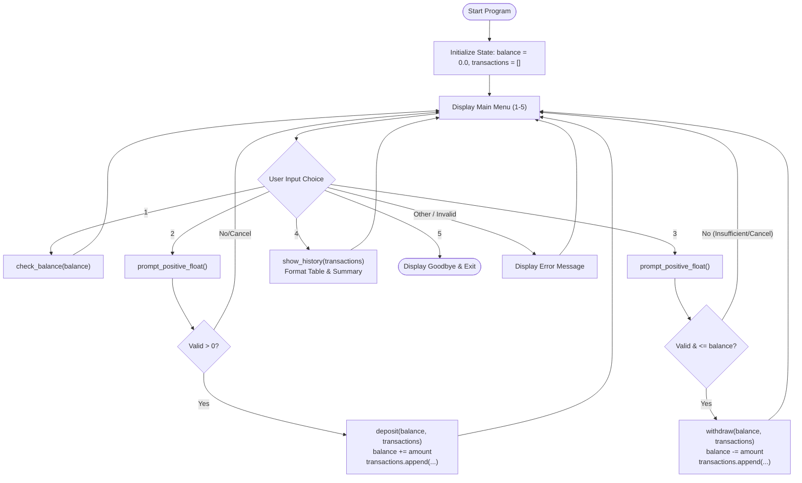

# 🏦 Menu-Driven Bank Account Simulator

> **Level 1 Python Internship Project**  
> **Topic**: Functions, Loops, Input Validation, and Clean State Management  
> **Dependencies**: Python Standard Library Only (Zero external packages)

---

## 📋 Table of Contents
1. [Project Overview](#-project-overview)
2. [Key Objectives & Learning Outcomes](#-key-objectives--learning-outcomes)
3. [Architecture & Workflow](#-architecture--workflow)
4. [Requirements Compliance Checklist](#-requirements-compliance-checklist)
5. [State Management Explained](#-state-management-explained)
   - [Why Avoid Global Variables?](#why-avoid-global-variables)
   - [Mutability vs Immutability in Python](#mutability-vs-immutability-in-python)
   - [Alternative Paradigm: Object-Oriented Approach (`BankAccount` Class)](#alternative-paradigm-object-oriented-approach-bankaccount-class)
6. [Functions & Implementation Details](#-functions--implementation-details)
7. [Validation & Error Handling Matrix](#-validation--error-handling-matrix)
8. [File Structure](#-file-structure)
9. [How to Run](#-how-to-run)
10. [Running the Test Suite](#-running-the-test-suite)
11. [Sample Execution Log](#-sample-execution-log)

---

## 🌟 Project Overview

The **Menu-Driven Bank Account Simulator** is an interactive, beginner-friendly console application developed for a Level 1 Python Programming internship. It models an automated teller machine (ATM) or personal banking account with core features including:
- Real-time balance inquiry with clean currency formatting (`₹` or `$`).
- Safe deposits with positive-value validation and decimal rounding.
- Safe withdrawals with balance solvency checks (preventing overdrafts).
- Full transaction ledger tracking timestamps, operation types, amounts, and resulting balances.
- Summary statistics (total deposited, total withdrawn, net transaction count).

---

## 🎯 Key Objectives & Learning Outcomes

This project is specifically engineered to practice foundational software engineering concepts in Python:

1. **Functions & Modularity**: Breaking business logic into single-responsibility, reusable functions (`check_balance`, `deposit`, `withdraw`, `show_history`, `main`).
2. **Control Flow & Loops**: Managing continuous user interaction with an infinite `while True` loop and robust menu routing (`if / elif / else`).
3. **Defensive Programming & Input Validation**: Intercepting invalid or non-numeric inputs using `try ... except ValueError` to eliminate runtime crashes.
4. **State Management Without Globals**: Passing state explicitly as function arguments and receiving updated values, eliminating the risks of global mutable state.
5. **Data Structures**: Modeling transactions as a list of dictionaries with ISO/standard timestamps using Python's standard `datetime` module.

---

## 📐 Architecture & Workflow



---

## ✅ Requirements Compliance Checklist

| # | Requirement | Specification | Implementation in Code |
|---|---|---|---|
| **1** | **Standard Library Only** | No third-party packages allowed (`pip install` free). | Uses only built-in Python tools: `sys`, `datetime`, `unittest`. |
| **2** | **Single File Script** | Application must reside in `bank_account_simulator.py`. | Fully self-contained in `bank_account_simulator.py`. |
| **3** | **Menu inside `while` loop** | 1. Check Balance<br/>2. Deposit<br/>3. Withdraw<br/>4. Transaction History<br/>5. Exit | Implemented in `main()` inside a clean `while True` loop with exact menu options. |
| **4** | **Dedicated Functions** | Separate operations into `check_balance()`, `deposit()`, `withdraw()`, `show_history()`, `main()`. | Every single operation has its own documented function with strict parameter boundaries. |
| **5** | **State Management** | Balance in variable, transactions in list of dicts. Avoid messy globals. | State is initialized locally in `main()` and passed between functions explicitly. |
| **6** | **Input Validation** | Reject non-numeric input, negative amounts, and handle overdrafts gracefully. | Handled via `prompt_positive_float()` with `try/except ValueError` and balance condition checks. |

---

## 🧠 State Management Explained

### Why Avoid Global Variables?
In introductory programming, beginners often resort to using Python's `global` keyword:
```python
# ❌ ANTI-PATTERN: Messy Global Variables
global_balance = 0.0

def deposit():
    global global_balance  # Dangerous! Any function can mutate this without warning.
    global_balance += 100
```
**Problems with globals:**
- **Hidden Dependencies**: It is impossible to tell what functions read or mutate `global_balance` without inspecting every line of code.
- **Testing Nightmare**: Automated tests cannot run concurrently or independently because global state leaks between test runs.
- **Side Effects**: Accidental overwrites lead to difficult-to-trace bugs.

### Mutability vs Immutability in Python
In `bank_account_simulator.py`, state is passed cleanly between functions:
```python
# ✅ BEST PRACTICE: Explicit State Passing
def main():
    balance = 0.0          # Immutable float
    transactions = []      # Mutable list

    # Balance is returned and reassigned:
    balance = deposit(balance, transactions)
```
1. **Numbers (`float`, `int`) are immutable**:
   When you do `balance += amount` inside a function, Python creates a **new float object** in local scope. Therefore, `deposit()` and `withdraw()` calculate the new balance and **return** it, allowing `main()` to rebind `balance`.
2. **Lists (`list`) are mutable**:
   When `transactions` is passed into `deposit()` or `withdraw()`, Python passes a reference to the same list object. Calling `transactions.append(record)` modifies the list in place!

---

### Alternative Paradigm: Object-Oriented Approach (`BankAccount` Class)
Requirement 5 notes: *"Either pass state between functions or use a small BankAccount class, whichever stays simpler."*

While explicit state passing between pure functions is chosen as the primary design for beginner clarity, here is how the exact same system can be implemented using an Object-Oriented `BankAccount` class:

```python
class BankAccount:
    """An Object-Oriented encapsulation of account state and operations."""
    
    def __init__(self, initial_balance=0.0):
        self.balance = initial_balance
        self.transactions = []

    def check_balance(self):
        print(f"Current Balance: ₹{self.balance:,.2f}")

    def deposit(self, amount):
        if amount <= 0:
            print("Amount must be positive.")
            return False
        self.balance += round(amount, 2)
        self.transactions.append({
            "type": "Deposit",
            "amount": amount,
            "balance_after": self.balance,
            "timestamp": datetime.now().strftime("%Y-%m-%d %H:%M:%S")
        })
        return True

    def withdraw(self, amount):
        if amount > self.balance:
            print("Insufficient funds.")
            return False
        self.balance -= round(amount, 2)
        self.transactions.append({
            "type": "Withdrawal",
            "amount": amount,
            "balance_after": self.balance,
            "timestamp": datetime.now().strftime("%Y-%m-%d %H:%M:%S")
        })
        return True
```
*Both paradigms achieve clean state isolation without global variables. The functional approach was selected as primary to align directly with the five specified standalone function signatures.*

---

## 🛠️ Functions & Implementation Details

### 1. `prompt_positive_float(prompt_message)`
- Continuously prompts the user using a `while True` loop.
- Intercepts non-numeric characters (`"abc"`, `"$$"`, spaces) via `try ... except ValueError`.
- Blocks negative numbers (`< 0`).
- Treats `0` as an intentional user cancellation, allowing the user to return to the main menu at any time.
- Rounds valid numbers to 2 decimal places.

### 2. `check_balance(balance)`
- Formats `balance` using standard financial notation: `{CURRENCY_SYMBOL}{balance:,.2f}`.
- Displays a clean visual card.

### 3. `deposit(balance, transactions, amount=None)`
- If `amount` is not provided (interactive mode), prompts the user via `prompt_positive_float()`.
- Validates that `amount > 0`.
- Calculates new balance with 2-decimal floating point precision.
- Appends a structured record dictionary to `transactions`:
  ```python
  {
      "type": "Deposit",
      "amount": amount,
      "balance_after": new_balance,
      "timestamp": "2026-10-17 13:40:11"
  }
  ```
- Returns updated `balance`.

### 4. `withdraw(balance, transactions, amount=None)`
- If `amount` is not provided (interactive mode), prompts the user.
- Checks solvency: `if amount > balance:`. If insufficient, displays available balance and shortfall, then aborts without mutating state.
- Deducts amount, records a `"Withdrawal"` transaction dictionary, and returns the new balance.

### 5. `show_history(transactions)`
- Displays a message if `transactions` is empty.
- When transactions exist, renders an ASCII-aligned tabular report (`#`, `Date & Time`, `Type`, `Amount`, `Balance After`).
- Computes aggregate metrics: Total Deposited, Total Withdrawn, and Total Count.

### 6. `main()`
- Initializes `balance = 0.0` and `transactions = []`.
- Drives the main menu loop until option `5` is selected.
- Intercepts `KeyboardInterrupt` (Ctrl+C) for graceful shutdown.

---

## 🛡️ Validation & Error Handling Matrix

| Scenario | Input | System Behavior | Outcome |
|---|---|---|---|
| Non-numeric deposit/withdraw | `"abc"`, `"fifty"` | Caught by `ValueError` | Displays error message and re-prompts user. |
| Negative amount | `"-100"` | Intercepted by numeric comparison (`< 0`) | Displays error message and re-prompts user. |
| Empty input / whitespace | `""`, `"   "` | Caught by `not raw_input` check | Displays error message and re-prompts user. |
| Overdraft / Insufficient balance | Withdraw `₹500` with `₹200` balance | Intercepted by `amount > balance` | Rejects transaction, shows shortfall, preserves balance. |
| Invalid menu option | `"9"`, `"deposit"`, `"-1"` | Falls into `else` branch in menu loop | Displays invalid choice warning and displays menu again. |
| User cancellation | Enters `0` during deposit or withdrawal | Detected as cancel sentinel | Returns to menu without altering balance or ledger. |
| Keyboard interrupt | User hits `Ctrl + C` | Caught by `except KeyboardInterrupt` | Prints exit message and terminates cleanly. |

---

## 📂 File Structure

```text
bank_account_simulator/
├── .gitignore                     # Git configuration ignoring cache files
├── bank_account_simulator.py       # Main application (Single-file requirement)
├── README.md                      # Comprehensive project documentation
├── run_simulator.bat              # One-click Windows execution launcher
├── sample_output.txt              # Captured full terminal session log
└── test_bank_account_simulator.py # Standard-library unittest suite (12 tests)
```

---

## 🚀 How to Run

### Option 1: Direct Python Command
Open a terminal in the project directory:
```bash
python bank_account_simulator.py
```

### Option 2: Windows Batch Runner
Double-click `run_simulator.bat` in Windows File Explorer, or run:
```cmd
run_simulator.bat
```

---

## 🧪 Running the Test Suite

The project includes 12 automated unit tests using Python's built-in `unittest` module. No third-party test runners are needed.

Run all tests:
```bash
python -m unittest test_bank_account_simulator.py
```

### Test Coverage Highlights:
- ✅ `test_check_balance_displays_formatted_amount`: Confirms currency formatting.
- ✅ `test_deposit_valid_amount`: Tests state update and dictionary keys.
- ✅ `test_deposit_multiple_times`: Verifies precision accumulation over multiple transactions.
- ✅ `test_deposit_zero_or_negative_rejected`: Checks rejection of zero and negative deposits.
- ✅ `test_withdraw_valid_amount`: Tests proper balance deduction.
- ✅ `test_withdraw_exact_balance`: Tests withdrawing down to exactly 0.00.
- ✅ `test_withdraw_insufficient_funds`: Ensures overdraft prevention and zero state modification.
- ✅ `test_withdraw_zero_or_negative_rejected`: Checks rejection of negative withdrawals.
- ✅ `test_show_history_empty`: Checks empty state message.
- ✅ `test_show_history_with_records`: Verifies table output, positive/negative amount signs, and summary totals.
- ✅ `test_prompt_positive_float_recovers_from_invalid_inputs`: Mocks invalid strings and verifies recovery.
- ✅ `test_main_menu_full_flow`: Mocks an end-to-end multi-step interactive session.

---

## 🖥️ Sample Execution Log

Here is an excerpt from a real interactive terminal session:

```text
====================================================
        WELCOME TO BANK ACCOUNT SIMULATOR
====================================================
  Manage your account simply, securely, and accurately.

================================
         BANKING MENU
================================
  1. Check Balance
  2. Deposit
  3. Withdraw
  4. Transaction History
  5. Exit
================================
Enter your choice (1-5): 1

=============================================
              ACCOUNT BALANCE
=============================================
  Available Balance : ₹0.00
=============================================

================================
         BANKING MENU
================================
  1. Check Balance
  2. Deposit
  3. Withdraw
  4. Transaction History
  5. Exit
================================
Enter your choice (1-5): 2

--- Deposit Funds ---
Enter amount to deposit (or 0 to cancel): ₹1000

---------------------------------------------
  ✅ DEPOSIT SUCCESSFUL
---------------------------------------------
  Deposited Amount : ₹1,000.00
  New Balance      : ₹1,000.00
---------------------------------------------

================================
         BANKING MENU
================================
  1. Check Balance
  2. Deposit
  3. Withdraw
  4. Transaction History
  5. Exit
================================
Enter your choice (1-5): 3

--- Withdraw Funds ---
Enter amount to withdraw (or 0 to cancel): ₹400

---------------------------------------------
  ✅ WITHDRAWAL SUCCESSFUL
---------------------------------------------
  Withdrawn Amount : ₹400.00
  New Balance      : ₹600.00
---------------------------------------------

================================
         BANKING MENU
================================
  1. Check Balance
  2. Deposit
  3. Withdraw
  4. Transaction History
  5. Exit
================================
Enter your choice (1-5): 4

===========================================================================
                           TRANSACTION HISTORY
===========================================================================
  #    Date & Time          Type                   Amount    Balance After
  -----------------------------------------------------------------------
  1    2026-10-17 13:41:07  Deposit            +₹1,000.00        ₹1,000.00
  2    2026-10-17 13:41:07  Withdrawal           -₹400.00          ₹600.00
  -----------------------------------------------------------------------
  Summary:
  • Total Deposits    : ₹1,000.00 (1 deposit)
  • Total Withdrawals : ₹400.00 (1 withdrawal)
  • Total Operations  : 2 records
===========================================================================

================================
         BANKING MENU
================================
  1. Check Balance
  2. Deposit
  3. Withdraw
  4. Transaction History
  5. Exit
================================
Enter your choice (1-5): 5

====================================================
   Thank you for using Bank Account Simulator!
               Have a great day! 👋
====================================================
```
